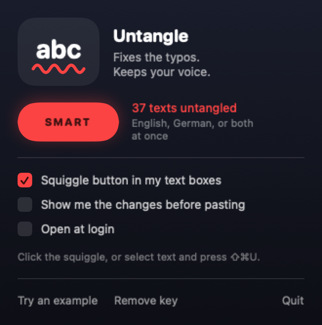
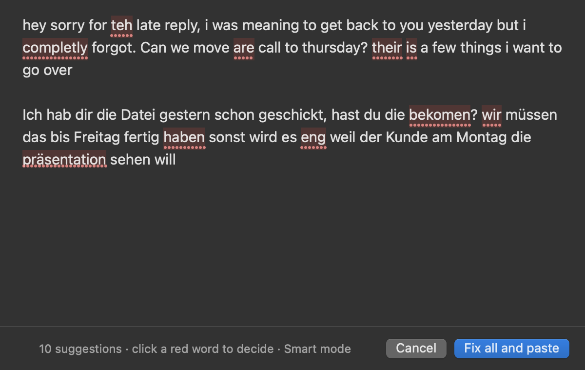

# Untangle

**Fixes the typos. Keeps your voice.**

A Mac menu bar proofreader that corrects what you typed without rewriting how you sound. English, German, or both in the same sentence.

<p>
  
  
</p>

## Why I built it

I type fast and messy, in English and German, often inside one sentence. Every writing tool I tried fixed more than I asked for. Gmail's polish and Grammarly corrected the typos, then carried on and rewrote me: casual turned formal, direct turned padded. I was sending messages that no longer sounded like me.

I did not want an editor. I wanted a proofreader that knows exactly where its job ends.

## What it does

- A small squiggle button sits inside whatever text box you are typing in. One click and the text is corrected in place, in about a second per sentence.
- No copying, no pasting, no second window. Or select text anywhere and press **Shift + Command + U**, or use right-click > Services > Untangle.
- Optional review mode shows every change underlined. Click one to accept it or keep your original.

## What makes it different

- **A rulebook of things it must never do.** Change the tone. Swap in a "better" word. Add a greeting. Remove slang, swearing, emoji or abbreviations. Make it more formal, or more casual. If a sentence is already correct, it comes back character for character.
- **Mixed languages count as deliberate.** If you write German and English in one sentence, each word is fixed in the language you meant it in. Nothing is translated.
- **It keeps your style.** All lowercase stays lowercase. "lol" stays "lol".
- **It fails safe.** If the AI cannot be reached, Untangle changes nothing and says so, rather than guess.

## How it works

1. **Find the text.** macOS Accessibility locates the text box in focus, in any app. Password fields are never read.
2. **Proofread.** In Smart mode the text goes to Claude (Anthropic's small, fast Haiku model) together with the proofread-only rulebook.
3. **Compare.** The app works out word by word what changed, so it can show you each change.
4. **Paste back.** The corrected text replaces the original.

There are two modes:

| Mode | What it fixes | Needs |
| --- | --- | --- |
| **Basic** | Spelling only, with the Mac's own spell checker. Works offline. | Nothing |
| **Smart** | Spelling, grammar, punctuation and tangled sentences. | Your own Anthropic API key |

Your API key is stored in the Mac's Keychain, never in a file. In Smart mode the text you untangle is sent to Anthropic's API and nowhere else.

The rulebook can be tuned without rebuilding the app: put your own version in `~/Library/Application Support/Untangle/prompt.txt`.

## Build it

Needs macOS 13 or later and the Xcode command line tools (no Xcode project).

```bash
./build.sh
```

This compiles `src/main.swift`, builds `Untangle.app` and installs it in `/Applications`. The squiggle button needs the Accessibility permission (System Settings > Privacy & Security > Accessibility); macOS asks again after each rebuild. Select-then-shortcut works without it.

To check the diff logic and Basic mode:

```bash
./build/Untangle --selftest
```

## How it was made

I am not a programmer. I decided what the app should do, wrote the rules it has to follow, and tested it in my real conversations until it stopped changing my tone. An AI coding assistant (Claude Code) wrote the Swift.
